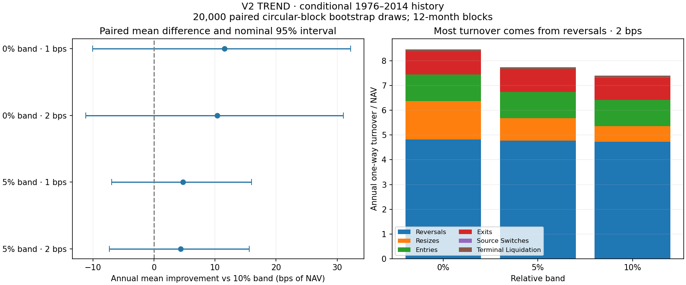

# Step 3: trading-band experiment

**Decision: retain the 10% relative trading band at the 2 bps primary cost.** The 0% and 5% alternatives offer small gains in historical mean return and CAGR, but neither meets the frozen evidence screen. Their paired uncertainty intervals include zero; both have lower Sharpe and deeper drawdowns. This does not prove the true return advantage is zero.

All 12 planned runs completed: v2 TREND and matching STATIC × 0/5/10% bands × 1/2 bps. Signals, covariance estimates, dates, execution timing and cost convention are fixed. Results remain **conditional on the unverified March 1997 endpoint assumption** and use already-inspected 1976–2014 history. No roll-cost work or new signal experiment has started.

## Main results

**V2 TREND**

| Band | CAGR at 1 bps | CAGR at 2 bps | Sharpe at 2 bps | Volatility at 2 bps | Drawdown at 2 bps | Turnover at 2 bps |
| --- | --- | --- | --- | --- | --- | --- |
| 0% | 11.57% | 11.47% | 1.076 | 10.67% | -15.16% | 8.47× |
| 5% | 11.51% | 11.42% | 1.084 | 10.53% | -14.78% | 7.74× |
| 10% | 11.47% | 11.39% | 1.092 | 10.41% | -14.44% | 7.41× |

**Matching STATIC**

| Band | CAGR at 1 bps | CAGR at 2 bps | Sharpe at 2 bps | Volatility at 2 bps | Drawdown at 2 bps | Turnover at 2 bps |
| --- | --- | --- | --- | --- | --- | --- |
| 0% | 4.98% | 4.96% | 0.462 | 12.11% | -57.52% | 1.49× |
| 5% | 5.11% | 5.10% | 0.477 | 11.96% | -56.72% | 0.90× |
| 10% | 5.18% | 5.17% | 0.486 | 11.85% | -55.91% | 0.72× |

The 10% band has the highest Sharpe and shallowest drawdown of the three bands for both portfolios at both cost assumptions. TREND gives up a small amount of historical compounded growth in exchange for lower fluctuations. STATIC also has higher CAGR with the 10% band.

## Gross performance versus costs saved

At 2 bps, moving TREND from no band to the 10% band cuts annual turnover from 8.467× to 7.408× NAV, a reduction of 12.5%. Annual direct costs fall from 0.169% to 0.148%, saving 2.12 bps of NAV per year.

The same change reduces annual gross arithmetic mean by 12.47 bps, leaving annual net mean 10.35 bps lower. **The band does not pay for itself through transaction-cost savings alone in this sample.** Retention rests on uncertainty about the small return gain and the observed risk tradeoff, not a claim that minimizing turnover maximizes returns. Each path was fully resimulated; these figures include fee feedback into NAV and holdings.

[Exact gross/cost/net decomposition for all candidates](output/paired_comparison.csv).

## Paired uncertainty and the decision screen

The comparison is candidate minus 10% band, using identical monthly dates and cost rates. Values below are **annual arithmetic-mean differences in bps of NAV**, not CAGR differences.

| Candidate band | Cost (bps) | Mean gain | Nominal 95% interval | Family-adjusted interval |
| --- | --- | --- | --- | --- |
| 0% | 1 | +11.53 | [-10.05, +32.20] | [-18.32, +41.25] |
| 0% | 2 | +10.35 | [-11.19, +31.03] | [-19.45, +40.10] |
| 5% | 1 | +4.73 | [-6.90, +15.95] | [-11.10, +20.40] |
| 5% | 2 | +4.35 | [-7.29, +15.58] | [-11.47, +20.02] |

The frozen screen requires at least 10 bps of annual mean improvement at both cost rates, positive family-adjusted lower bounds for all three bootstrap block lengths, and improvement in at least three of four historical blocks. Drawdown, calibration and tracking are then reviewed before adoption. The 10 bps threshold is a declared research convention, not an estimated optimum.

The calculation uses 20,000 circular moving-block draws, resampling the **paired difference vectors together**. The primary block length is 12 months; 6 and 24 months are sensitivity checks. Nominal intervals use percentile bounds. Bonferroni bounds use 0.3125% and 99.6875% quantiles for eight comparisons (two candidate bands × two costs × two portfolios), providing approximate 95% family coverage for each block length. They do not account for the entire earlier strategy search or remove nonstationarity and data-provenance uncertainty. No block length was selected for its most favorable result.

The no-band candidate meets the mean-gain threshold and improves mean return in all four blocks, but fails the uncertainty requirement. The 5% band also fails the mean-gain threshold; it improves three of four blocks. Both fail the adjusted-interval requirement. **No candidate is promoted.** [All intervals](output/paired_intervals.csv) · [Frozen specification](output/trial_specification.json) · [Screen results](output/candidate_screen.json).

## Stability across historical blocks

TREND annual mean gain versus the 10% band, at 2 bps:

| Candidate | Historical block | Gain (bps/year) |
| --- | --- | --- |
| 0% | 1976–1984 | +3.05 |
| 0% | 1985–1994 | +8.48 |
| 0% | 1995–2004 | +9.09 |
| 0% | 2005–2014 | +20.06 |
| 5% | 1976–1984 | +2.65 |
| 5% | 1985–1994 | +5.77 |
| 5% | 1995–2004 | -3.33 |
| 5% | 2005–2014 | +12.15 |

Both costs give the same positive-block counts. These windows describe the existing trading paths; they are not fresh holdouts or independently optimized/restarted portfolios. [All subperiod return, risk and drawdown metrics](output/subperiods.csv).

## What the band changes

Annual TREND turnover by trade type, at 2 bps (units of NAV per year):

| Trade type | 0% band | 5% band | 10% band |
| --- | --- | --- | --- |
| Resizes | 1.559 | 0.907 | 0.627 |
| Reversals | 4.819 | 4.771 | 4.735 |
| Entries | 1.070 | 1.062 | 1.061 |
| Exits | 0.941 | 0.923 | 0.908 |
| Source Switches | 0.002 | 0.002 | 0.002 |
| Terminal Liquidation | 0.076 | 0.076 | 0.075 |

The main reduction comes from **resizing existing same-direction positions**. Source switches include the full close/open legs and take precedence over the other categories; they are not added again to reversal turnover. Resizes include any reductions imposed by hard risk limits. Entry, reversal and liquidation quantities can differ slightly because carried holdings and portfolio scaling differ.

All **1,648 instrument-level target sign reversals** execute in the correct direction in the same month under every band and cost case. Bands do not postpone those direction changes. Their sizes can still differ because hard portfolio limits override targets. [Execution checks](output/reversal_execution.csv).

The descriptive before/during/after reversal-month comparison is in [reversal diagnostics](output/reversal_diagnostics.csv). There is at least one instrument reversal in 438 of 468 months, so these overlapping portfolio-level windows are not an isolated-event study and offer little independent evidence about rare turning points. They are not used as a selection criterion.

## Risk and target tracking

TREND at 2 bps:

| Band | Average gross exposure | Risk calibration | Mean distance to bounded target | Mean distance to raw target |
| --- | --- | --- | --- | --- |
| 0% | 2.461× | 1.265 | 0.000× | 0.385× |
| 5% | 2.419× | 1.269 | 0.078× | 0.436× |
| 10% | 2.381× | 1.272 | 0.139× | 0.480× |

Target distance is the sum of absolute exposure differences, averaged over months, in units of beginning-month NAV. The bounded target applies the existing gross/risk limits before bands; the raw target is the inverse-volatility signal position before those portfolio limits. Even the zero-band run can differ slightly from its bounded target because fees require further reductions. Wider bands allow more tracking deviation. The calibration shortfall remains under every band; a band change does not solve it.

## Validation and reproducibility

- **143 tests pass**, including trade decomposition with drift, reversal, source close/open and final liquidation, plus paired-bootstrap checks.
- All 12 simulations cover 468 months and reconcile costs, gross/net P&L and turnover categories. No rebalance gross/risk-limit breaches occur. The eight shared 0/10% runs reproduce Step 2 within numerical tolerance. [Validation](output/validation.json).
- Verified all Step 2 artifact hashes and all 65 raw-input hashes before execution. The experiment uses the frozen Step 2 conditional return panel, source schedule and known-at dates. It does not substitute a new data scenario or claim a new raw reconstruction.
- The production risk config, raw files and prior result packages remain unchanged. [Reproduction guide](REPRODUCE.md) · [Trial/source manifest](provenance.json).

**Stop after Step 3.** Step 4 is the contract/roll-data audit and separate roll-cost accounting, subject to the data gate. It has not started.
