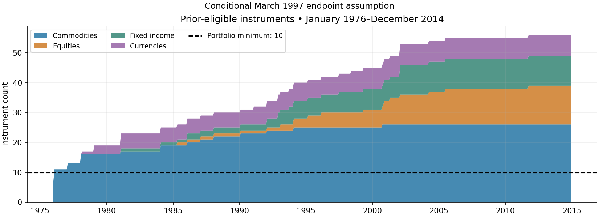
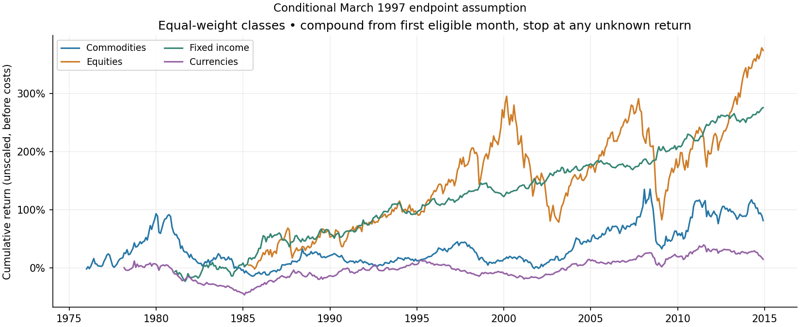
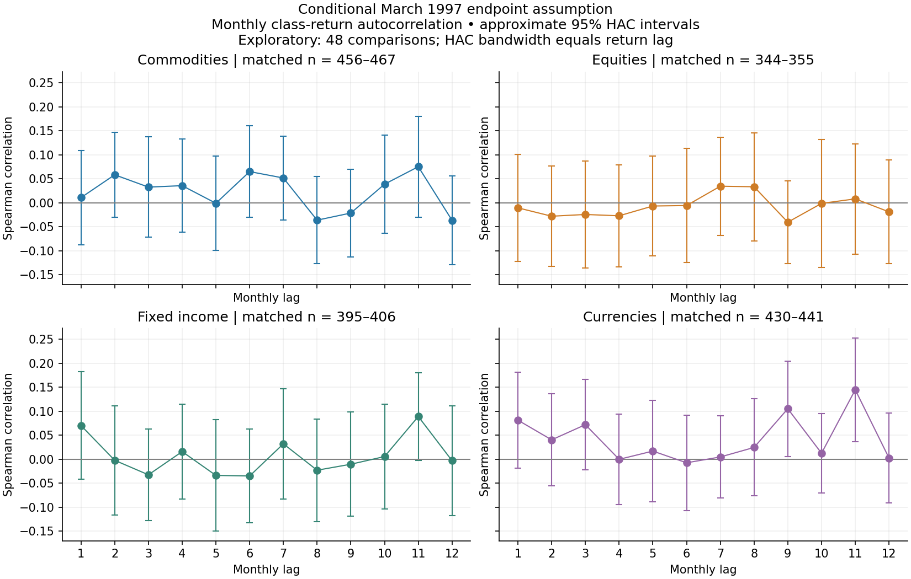
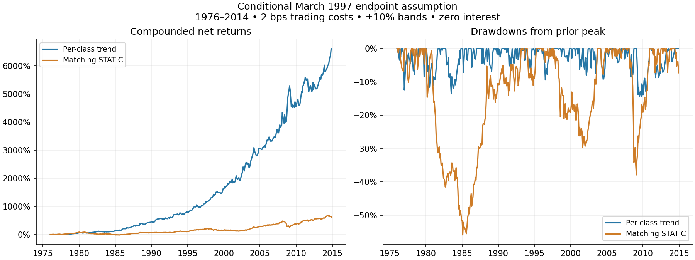
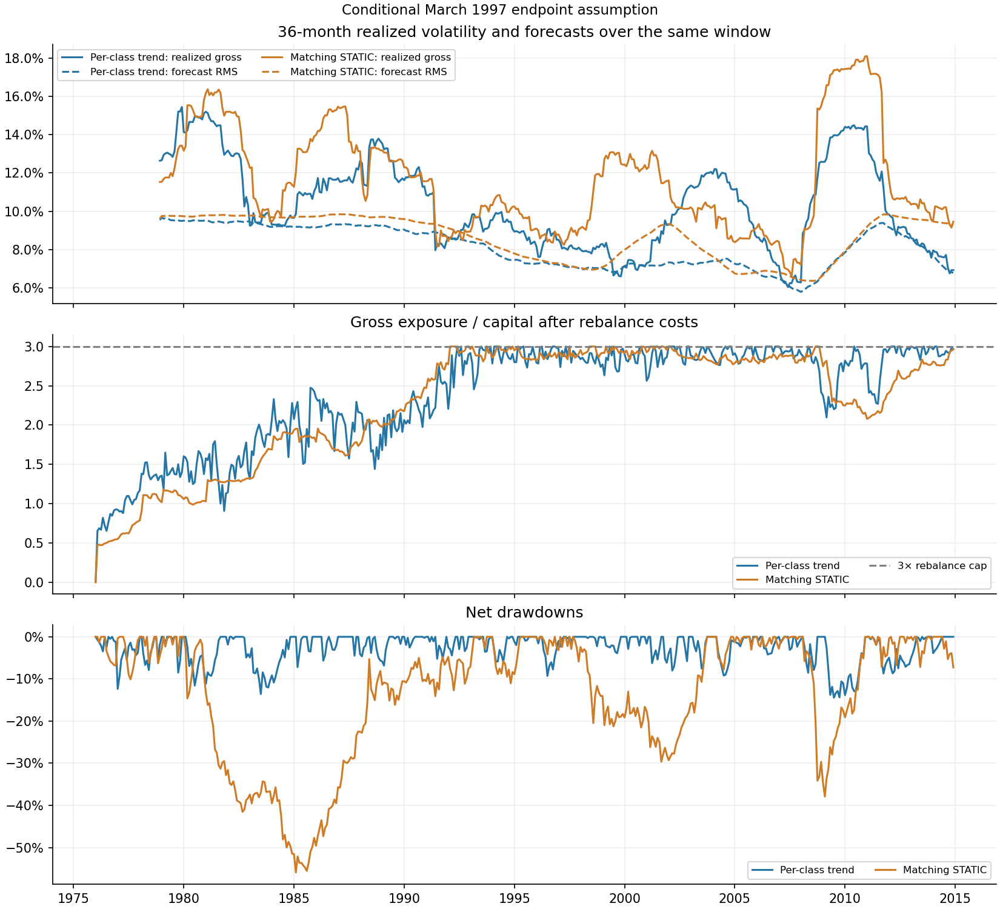

# Managed futures: risk-controlled trend

**Research question:** does following trends whose signal is chosen for each asset class add value over staying long when both portfolios use the same risk controls and trading costs?

**Key finding:** trend improves full-sample return, Sharpe and drawdown versus the always-long benchmark. The advantage is smaller in the most recent decade, and risk forecasts understate realized fluctuations.

**Data qualification:** results use an unverified March 1997 endpoint assumption for DT, GS, LX and SS, restoring eight March/April returns. The preserved-policy run stops on missing held returns. [Evidence](../../docs/ENDPOINT_DECISION.md) · [Data status](supporting_docs/DATA_STATUS_V2.md).

## 1. Data description

| Item | Definition |
|---|---|
| Sample | January 1976–December 2014; 468 months |
| Inputs | Monthly returns, daily futures prices and a market/class map |
| Universe | 58 retained series across commodities, equities, fixed income and currencies |
| Preparation | Remove duplicate exposures and exclude YM/EC; apply audited endpoint rules |
| Information | Prior observations only for signals, risk estimates and RL/ER source selection |

January 1976 has 7 eligible instruments, below the required 10, so it remains flat. Trading starts in 1976-02; earlier data initialize the estimation windows.

**Takeaway:** the opportunity set grows over time; all requested months are retained, including the initial flat month.

## 2. Summary statistics across asset classes

**Method:** each monthly class return equally weights markets eligible before that month. These are unscaled, long-only class returns before trading costs. Compute statistics from each class portfolio, rather than averaging individual-market statistics.

| Class | Markets | Months | Annual mean | Annual volatility | Sharpe |
| --- | ---: | ---: | ---: | ---: | ---: |
| Commodities | 26 | 468 | 2.32% | 12.54% | 0.19 |
| Equities | 13 | 356 | 6.54% | 15.89% | 0.41 |
| Fixed income | 10 | 407 | 4.23% | 8.03% | 0.53 |
| Currencies | 7 | 442 | 0.73% | 8.40% | 0.09 |

Annual mean = 12 × monthly mean; annual volatility = √12 × monthly sample SD. Sharpe assumes zero cash return. Histories differ across classes; missing eligible returns are not filled or silently reweighted.

**Takeaway:** fixed income has the highest descriptive Sharpe and currencies the lowest. Unequal coverage limits direct comparisons across classes.

## 3. Autocorrelation

**Question:** do stronger class returns tend to be followed by stronger returns? Compare each monthly class return with its return 1–12 months earlier using Spearman rank correlation. Calendar gaps are preserved; the chart shows approximate 95% intervals allowing for serial dependence.

| Class | Lags with approximate p < 0.05 |
| --- | ---: |
| Commodities | 0/12 |
| Equities | 0/12 |
| Fixed income | 0/12 |
| Currencies | 2/12 |

**Takeaway:** evidence of class-level persistence is limited. These 48 exploratory comparisons have no multiple-testing adjustment and do not establish the profitability or optimality of the per-class trading signals.

## 4. Baseline strategy construction

1. **Direction:** go long if the market's signal is positive, short if negative, and flat if zero. The signal depends on the asset class: COMM uses the sum of the previous 12 monthly returns; FI uses the sum of the previous 12 monthly returns; EQ uses the sum of the previous 12 monthly returns; FX uses the average of the signs of the sum of the previous 3 monthly returns and the sum of the previous 12 monthly returns (full size when both signs agree and are nonzero; flat when they oppose; half size when one sign is zero).
2. **Risk estimate:** use the previous 36 months of returns, a 2% annual volatility floor, and correlations shrunk 50% toward zero.
3. **Position size:** start with `0.40 / (eligible markets × annual volatility)`, then reduce positions proportionally to meet a **10% forecast-volatility ceiling** and **3× gross exposure cap**. The 0.40 is a sizing parameter, not a portfolio risk target.
4. **Execution:** rebalance monthly with ±10% relative trading bands. A 20% target allows an existing same-direction position between 18.0% and 22.0%. Entries, exits and reversals execute at target; hard limits override bands.

**Benchmark:** STATIC stays long using the same eligibility, risk model, limits, bands and costs. Each portfolio's own forecast risk determines its scaling.

**Takeaway:** the comparison isolates the value of trend direction under matching controls. This is a risk-controlled baseline; it scales down to a ceiling rather than scaling up to a volatility target.

## 5. Baseline strategy results

1976–2014, net of **2 bps per unit of one-way traded notional / beginning-period NAV** (no division of turnover by two), with ±10% bands and zero cash return. CAGR measures compounded growth; maximum drawdown is the largest peak-to-trough loss.

| Metric | TREND | STATIC |
| --- | ---: | ---: |
| Annual arithmetic mean | 11.37% | 5.76% |
| Compounded annual growth (CAGR) | 11.39% | 5.17% |
| Net Sharpe | 1.09 | 0.49 |
| Maximum drawdown | -14.44% | -55.91% |

**Takeaway:** trend delivers stronger full-sample growth and risk-adjusted performance, with a much smaller historical drawdown. Results are conditional and in sample.

**Recent period (2005–2014):** trend CAGR is 7.84% versus STATIC's 6.46%; Sharpe is 0.83 versus 0.58. The full-sample return advantage is not uniform. This is an inspected historical subsample, not a fresh holdout.

**Cost sensitivity — TREND:**

| Trading cost (bps) | CAGR | Sharpe |
| --- | ---: | ---: |
| 0 | 11.55% | 1.11 |
| 1 | 11.47% | 1.10 |
| 2 | 11.39% | 1.09 |
| 5 | 11.15% | 1.07 |

The band reduces turnover by 12.5% versus no band. Costs cover actual trades, including entries, source switches and liquidation; historical spread, impact and roll costs remain unverified.

## 6. Baseline strategy risk characteristics

### Full-sample realized risk

| Portfolio | Realized net volatility | RMS forecast volatility | Average gross exposure | Calibration ratio |
| --- | ---: | ---: | ---: | ---: |
| TREND | 10.41% | 8.17% | 2.38× | 1.27 |
| STATIC | 11.85% | 8.75% | 2.28× | 1.41 |

Realized annual volatility is √12 × the SD of all 468 monthly net returns. RMS summarizes the changing annual gross-risk forecasts. Calibration measures variability after scaling each gross monthly return by its preceding forecast monthly volatility: **1 is ideal; above 1 means risk was underpredicted**.

### Risk through time

The upper panel compares realized **gross** volatility with RMS forecasts over the same trailing 36 months. The other panels show exposure and net drawdowns. Full rolling estimates begin after 36 observations; limits apply at monthly rebalances, and exposures can drift between them.

### Where risk and returns come from

| Class | Annual net return contribution | Average forecast-volatility contribution |
| --- | ---: | ---: |
| Commodities | 6.17% | 4.94% |
| Equities | 1.63% | 1.20% |
| Fixed income | 1.66% | 1.01% |
| Currencies | 1.92% | 0.89% |

Return and forecast-risk contributions add to their respective portfolio totals. Class volatilities do not add, and the strategy does not impose equal risk across classes.

**Takeaway:** forecasts understate realized fluctuations, and commodities contribute most of the average forecast risk. A 10% forecast ceiling is not a realized-volatility cap or a loss guarantee.

## 7. Conclusions and next steps

**Conclusion:** following trends improves full-sample performance versus matching STATIC in this conditional study. The recent return advantage is smaller, and risk calibration needs improvement.

1. **Verify data and execution:** resolve the March 1997 endpoints and check executable prices, roll conventions and costs.
2. **Improve risk calibration:** evaluate a more responsive estimator and deliberate class-risk budgets.
3. **Test new history:** freeze the rules and evaluate an untouched sample before forward paper trading.

**Takeaway:** the historical findings justify further testing; they do not establish future performance or superiority over a matched academic baseline.

Discussion notes and supporting evidence

- **Return comparison:** TREND/STATIC correlation is 0.14. Annualized regression alpha is 10.69%, with a 95% HAC interval of [7.67%, 13.70%]. Alpha is 12 × the monthly intercept against STATIC; six HAC lags are used. The interval excludes strategy-selection and data-provenance uncertainty.
- **Autocorrelation uncertainty:** rank regressions use calendar-spaced Bartlett HAC scores, bandwidth equal to the return lag, n/(n−2) correction and t(n−2) intervals. [All estimates](output/endpoint_sensitivity_v2/autocorrelation.csv).
- **Data continuity:** RL/ER is one exposure; the switch to ER in 2006-01 uses history known through t−2. Class compounding starts at the first eligible month and stops at an unknown subsequent return.
- **Model scope:** the presentation covers QPS's fixed 36-month risk model, ceiling and bands. The separate academic TSMOM run uses compounded signals, daily EWMA volatility, zero costs and a different missing-return policy; its results are not a matched comparison.

| Portfolio | Annual turnover / capital | Annual direct cost drag |
| --- | ---: | ---: |
| TREND | 7.41× | 0.148% |
| STATIC | 0.72× | 0.014% |

**Validation:** 140 tests pass; the historical validation record reports a matching 12-run replay for 2000–2014. Validation checks accounting and timing, not vendor accuracy or executable fills.

[Methods](../../docs/RISK_METHODS.md) · [Validation](../../docs/VALIDATION.md) · [Code guide](../../docs/CODE_GUIDE.md) · [All cost scenarios](output/endpoint_sensitivity_v2/comparison.csv) · [Historical subsamples](output/endpoint_sensitivity_v2/stability.csv) · [Class attribution](output/endpoint_sensitivity_v2/trend_class_attribution.csv).

Reproduce: `python scripts/run_research.py --variant v2 --endpoint-sensitivity`. HTML embeds all five figures.

