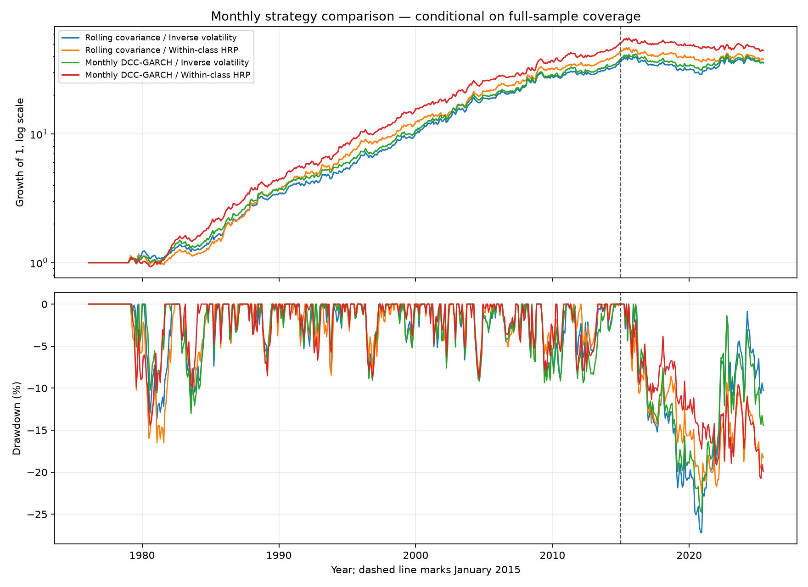

# Monthly full-sample strategy results

**COVERAGE-CONDITIONED RESEARCH RESULTS: the market set uses availability through May 2025. The 2015–2025 test calendar is not an untouched out-of-sample universe.**

The conditional run uses 48 fixed markets with uninterrupted supplied returns from their first observation through May 2025. Leading pre-inception blanks are allowed; markets enter only after the common prior-history requirements are met. Selection uses the full file's availability, so survivorship and availability selection can affect all reported comparisons. Return magnitudes do not select markets. All declared calendar months remain in the ledgers, including any initially flat months when fewer than 10 markets meet the common history requirements. The strategy holds zero exposure until ready; no threshold or start date is changed to force activity. First active months: monthly_dcc_garch_hrp_within_class: 1979-01; monthly_dcc_garch_inverse_vol: 1979-01; rolling_hrp_within_class: 1979-01; rolling_inverse_vol: 1979-01. Eligible markets at the declared start: 6.

## Development: January 1976–December 2014

| Risk model | Sizing | Months | Annual net mean | CAGR | Annual volatility | Sharpe (RF=0) | Maximum drawdown | Annual turnover | Annual cost | Positive months |
| --- | --- | --- | --- | --- | --- | --- | --- | --- | --- | --- |
| Rolling covariance | Inverse volatility | 468 | 9.64% | 9.65% | 8.92% | 1.081 | -13.63% | 6.77× | 0.14% | 58.5% |
| Rolling covariance | Within-class HRP | 468 | 10.11% | 10.16% | 8.94% | 1.130 | -16.50% | 11.90× | 0.24% | 58.3% |
| Monthly DCC-GARCH | Inverse volatility | 468 | 9.73% | 9.77% | 8.71% | 1.117 | -13.02% | 6.83× | 0.14% | 59.0% |
| Monthly DCC-GARCH | Within-class HRP | 468 | 10.45% | 10.60% | 8.25% | 1.267 | -14.43% | 11.57× | 0.23% | 61.1% |

## Test calendar: January 2015–May 2025

| Risk model | Sizing | Months | Annual net mean | CAGR | Annual volatility | Sharpe (RF=0) | Maximum drawdown | Annual turnover | Annual cost | Positive months |
| --- | --- | --- | --- | --- | --- | --- | --- | --- | --- | --- |
| Rolling covariance | Inverse volatility | 125 | 0.24% | -0.17% | 9.12% | 0.026 | -27.20% | 10.34× | 0.21% | 48.0% |
| Rolling covariance | Within-class HRP | 125 | -0.92% | -1.25% | 8.17% | -0.113 | -22.51% | 16.70× | 0.33% | 48.8% |
| Monthly DCC-GARCH | Inverse volatility | 125 | -0.17% | -0.57% | 8.98% | -0.019 | -24.78% | 10.79× | 0.22% | 48.0% |
| Monthly DCC-GARCH | Within-class HRP | 125 | -1.00% | -1.27% | 7.51% | -0.133 | -20.75% | 17.11× | 0.34% | 42.4% |

## Combined: January 1976–May 2025

| Risk model | Sizing | Months | Annual net mean | CAGR | Annual volatility | Sharpe (RF=0) | Maximum drawdown | Annual turnover | Annual cost | Positive months |
| --- | --- | --- | --- | --- | --- | --- | --- | --- | --- | --- |
| Rolling covariance | Inverse volatility | 593 | 7.66% | 7.50% | 9.02% | 0.849 | -27.20% | 7.52× | 0.15% | 56.3% |
| Rolling covariance | Within-class HRP | 593 | 7.78% | 7.65% | 8.87% | 0.877 | -22.51% | 12.91× | 0.26% | 56.3% |
| Monthly DCC-GARCH | Inverse volatility | 593 | 7.64% | 7.50% | 8.84% | 0.865 | -24.78% | 7.66× | 0.15% | 56.7% |
| Monthly DCC-GARCH | Within-class HRP | 593 | 8.04% | 7.98% | 8.20% | 0.980 | -20.75% | 12.74× | 0.25% | 57.2% |



## Strict all-market check

| Case | end | Error | start | Status |
| --- | --- | --- | --- | --- |
| full_sample_rolling_inverse_vol_shadow | 2025-05 | Missing held return at 1997-03: ['DT', 'GS', 'LX'] | 1976-01 | BLOCKED |
| test_period_rolling_inverse_vol_shadow | 2025-05 | Missing held return at 2015-06: ['ZD'] | 2015-01 | BLOCKED |

An unknown return on an existing holding stops that attempt. The conditional table does not repair or substitute values for the omitted markets.

## Omitted markets

| Market | Missing months after first observation | Reason |
| --- | --- | --- |
| AP | 33 | Incomplete coverage after inception through the declared sample end |
| DT | 2 | Incomplete coverage after inception through the declared sample end |
| EC | 25 | Predeclared strategy exclusion: Instrument identity/classification unresolved; omit from strategy rather than assign an unverified class. |
| GS | 2 | Incomplete coverage after inception through the declared sample end |
| HS | 4 | Incomplete coverage after inception through the declared sample end |
| LX | 2 | Incomplete coverage after inception through the declared sample end |
| SS | 60 | Incomplete coverage after inception through the declared sample end |
| XX | 4 | Incomplete coverage after inception through the declared sample end |
| YM | 0 | Predeclared strategy exclusion: Duplicate Dow exposure; retain older ZD series. |
| ZD | 120 | Incomplete coverage after inception through the declared sample end |

## Method and interpretation

Only the professor's full monthly-return workbook and asset map supply market inputs. The workbook's RL series is used as supplied, with no reconstruction or daily ER override. No missing return is filled, and no portfolio month is dropped.

The four variants cross rolling covariance or monthly DCC-GARCH with inverse-volatility or signed within-class HRP sizing. All use the same eligibility set, 36 complete prior monthly observations and at least 60 observations available at the annual GARCH fit. The minimum portfolio universe is 10 markets. Eligibility and forecasts use past inputs.

GARCH and DCC parameters are estimated at monthly frequency on expanding past data, refitted annually using the prior December cutoff. The next-month covariance is annualized by 12; daily parameters and 21-day aggregation are not used. This is a new monthly specification, not a replication of the archived daily-GARCH strategy.

Shared controls are 10% correlation shrinkage, a 2% annual instrument-volatility floor, 3× gross exposure cap, 10% forecast annual portfolio-risk ceiling, 10% trading band and 2 bps per unit of absolute one-way traded notional. Cash interest is zero. The baseline rescale is estimated from each risk model's inverse-volatility shadow portfolio using 60 prior calendar months with at least 24 valid observations, then shared with its HRP arm.

Signals use the sign of the preceding 12-month return sum for commodities, fixed income and equity indices. FX blends the 3-month and 12-month signals. Monthly decisions use information through the previous month; fills at the previous endpoint are idealized.

Each variant runs as one continuous portfolio from January 1976 through May 2025. The development and test tables summarize slices of that ledger. Holdings, risk calibration and NAV continue across December 2014; there is no restart or liquidation there. Initial entry and May 2025 liquidation costs belong to their actual ledger months.

Annual net mean is 12 times the monthly arithmetic mean; annual volatility is the monthly sample standard deviation times √12. Sharpe is annual net mean divided by annual volatility with RF=0. CAGR compounds returns over the stated calendar. Drawdown is rebased at the start of each displayed period; turnover and cost are 12 times their monthly means. Subperiod CAGR is a return summary, not a separately executed account.

The 2015–May 2025 rows are a chronological test of fixed rules with sequential past-only updates. The full-sample coverage rule and prior inspection of this dataset prevent calling them independently untouched out-of-sample evidence. Differences are descriptive; this table alone does not establish a statistically reliable or executable advantage.

## Verify or reproduce

Run from the repository root; use a new output directory.

```sh
PYTHONPATH=. .venv/bin/python scripts/run_monthly_full_sample.py --verify-existing reports/monthly_full_sample_20261116

PYTHONPATH=. .venv/bin/python scripts/run_monthly_full_sample.py --output reports/my_monthly_run
```

See metrics.csv for unrounded values, checks.csv for verification, model_parameters.csv for actual fitted parameters, universe_audit.csv for coverage and status.json for the complete run status.
