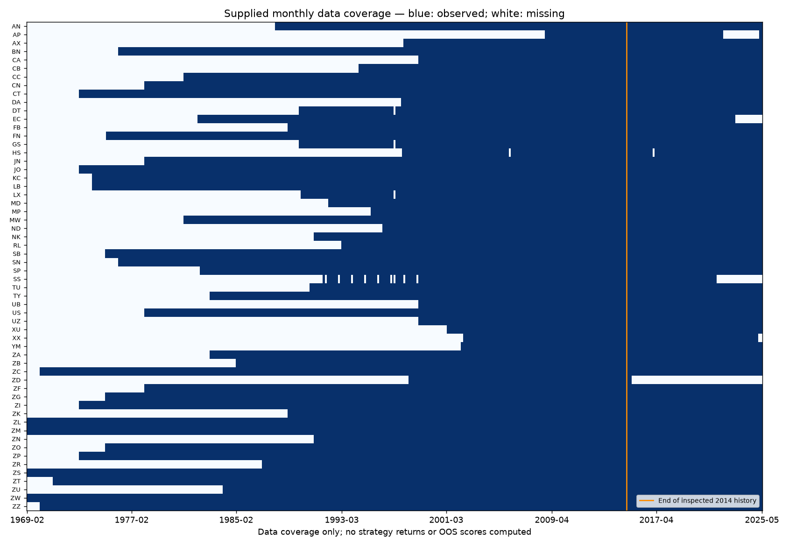
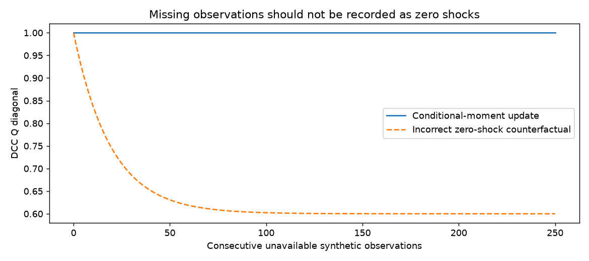

# Research verification

**Automated verification: PASS.**

**Real-data daily GARCH: blocked — daily price files are absent.**

Passing code checks does not establish profitable or independently validated performance.

## Supplied inputs

| Supplied file | Archived identity |
| --- | --- |
| AssetMapCsv.csv | PASS |
| MonthlyReturns.csv | PASS |
| Lecture3_livedata.xlsx | PASS |
| MonthlyReturns_FullSample.xlsx | NEW_INPUT |

PASS means byte-for-byte identity with the archived original. NEW_INPUT means the full-sample workbook has no archived original hash; its current hash is recorded.

Full sample: **1969-02 through 2025-05**, 676 months and 58 markets. Returns are decimal units: 0.01 means 1%. No scaling or filling was performed.

The original overlap has 0 observed changes beyond the declared CSV-rounding/Excel-representation tolerance and 6 newly supplied cells. The exact additions are shown below; they are not automatic venue-calendar repairs.

Overlap tolerance: Half the original CSV token's last decimal unit plus 1e-12 decimal units for Excel/float representation; exact zeros use 1e-12.


| month | market | change | full_sample |
| --- | --- | --- | --- |
| 2014-12 | AX | added | -0.0199146771531391 |
| 2014-12 | DT | added | 0.0130378096479792 |
| 2014-12 | UB | added | 0.00522691446112988 |
| 2014-12 | UZ | added | 0.00145006344027542 |
| 2014-12 | XU | added | -0.0351435903408339 |
| 2014-12 | XX | added | -0.028270709864628 |





## Data issues still requiring review


| Market | Missing months after development | Last observed month |
| --- | --- | --- |
| AP | 33 | 2025-05 |
| EC | 25 | 2023-04 |
| HS | 2 | 2025-05 |
| SS | 42 | 2021-11 |
| XX | 4 | 2025-01 |
| ZD | 120 | 2015-05 |


| Market | Gap start | Gap end | Missing months | Resumed | Return when resumed |
| --- | --- | --- | --- | --- | --- |
| AP | 2022-06 | 2025-02 | 33 | 2025-03 | +22.71% |
| EC | 2023-05 | 2025-05 | 25 |  | Not resumed |
| HS | 2017-01 | 2017-02 | 2 | 2017-03 | +1.64% |
| SS | 2021-12 | 2025-05 | 42 |  | Not resumed |
| XX | 2025-02 | 2025-05 | 4 |  | Not resumed |
| ZD | 2015-06 | 2025-05 | 120 |  | Not resumed |


Large returns after gaps require vendor/source/interval review. ZD and YM continuity also needs review before any source transition; no replacement is chosen retrospectively.

10 of the ten flagged March/April 1997 DT/GS/LX/SS and January/February 2006 HS cells are still missing. See [exact cells](input_audit/known_endpoint_cells.csv) and [post-development gaps](input_audit/post_development_missing_runs.csv).

## What the code checks establish

- Automated tests: 372 tests, exit 0; [test log](checks/pytest.log), [individual tests](checks/test_results.xml).

- Type checks: exit 0; [log](checks/mypy.log).

- Ruff: 0 new findings in modified/new files; 132 existing repository findings remain.

- [Readable GARCH numerical checks](garch_checks/SUMMARY.md) use reproducible **synthetic daily observations**, not this monthly workbook or real trading performance.

## What is not established

Only 0 of 62 original daily price files are present. Monthly returns cannot recreate the missing daily observations needed by the configured DCC-GARCH model or verify source-specific endpoints.

The 125 months after the inspected 2014 history are potential evaluation data. Prior access and vendor conventions are not independently certified. No strategy was scored on them, and no OOS advantage is claimed.

## Numerical evidence: synthetic daily fixture

These are filter-state and code checks, not strategy profits. The expected recurrence is calculated independently; the mutation/prefix checks refit actual production models.



| check | passed | detail |
| --- | --- | --- |
| Missing GARCH dates advance expected variance | PASS | Maximum difference from the independent recurrence: 2.71e-20. |
| Missing observations differ from zeros and compressed time | PASS | See variance_trace.csv; counterfactual paths are illustrative failure modes. |
| DCC missing residuals use conditional second moments | PASS | Maximum error across fully/partly/unobserved cases: 0. |
| Unavailable DCC shocks do not become observed zeros | PASS | After 250 missing updates: fixed Q diagonal 1.000000; zero-shock counterfactual 0.600001. These are filter states, not portfolio returns. |
| GARCH rejects an unsuccessful optimizer | PASS | A scoped mock supplies success=False and a NaN objective. |
| DCC rejects an unsuccessful optimizer | PASS | A scoped mock supplies success=False and a NaN objective. |
| Real optimizer restored after failure checks | PASS | All later forecast fits call the actual SciPy optimizers. |
| RL risk uses ER after RL quotes end | PASS | 107 nonmissing synthetic ER risk returns remain after RL ends. |
| Lag 1: future mutation preserves earlier covariance | PASS | Maximum covariance difference through 2002-02: 0. |
| Lag 1: truncated history preserves earlier covariance | PASS | Maximum covariance difference through 2002-02: 0. |
| Excluded markets and their extra dates leave forecasts unchanged | PASS | Maximum covariance difference: 0; retained daily grids equal. |
| Lag 1: actual annual GARCH/DCC fits converge | PASS | Verified 1 annual refit(s), including January information timing. |
| Lag 1: retained forecast block is positive definite | PASS | Smallest eigenvalue across exported months: 0.00887365. |
| Lag 2: future mutation preserves earlier covariance | PASS | Maximum covariance difference through 2002-02: 0. |
| Lag 2: truncated history preserves earlier covariance | PASS | Maximum covariance difference through 2002-02: 0. |
| Lag 2: actual annual GARCH/DCC fits converge | PASS | Verified 2 annual refit(s), including January information timing. |
| Lag 2: retained forecast block is positive definite | PASS | Smallest eigenvalue across exported months: 0.00887365. |

## Verify this yourself

From the repository root:

```sh
.venv/bin/python scripts/verify_research.py --verify-existing reports/research_verification_20261116
.venv/bin/python scripts/verify_research.py --output reports/my_verification
```

The first command checks saved output, input and source hashes. The second regenerates the audits and reruns all checks in a **new** directory. A successful exit means the verification completed; the real-data GARCH status above remains separate. [Detailed guide](../../docs/VERIFYING_RESULTS.md).
