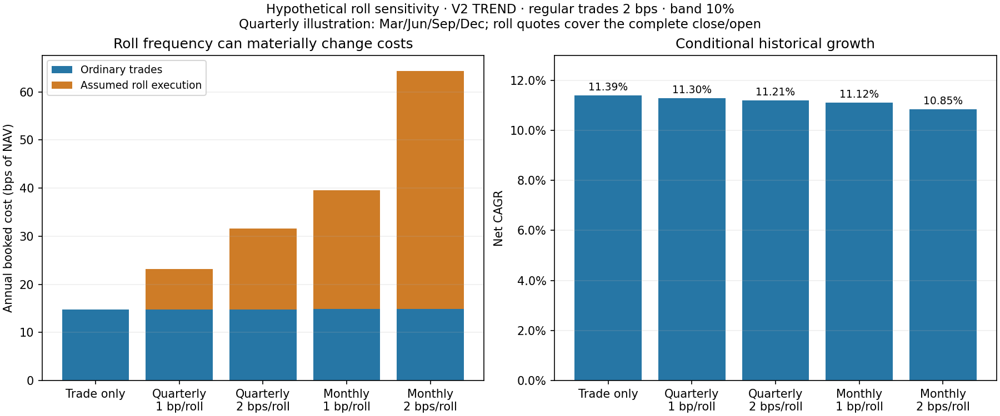

# Step 4: roll-cost audit and conditional sensitivity

**Step 4 is complete as an assumption-based sensitivity. A verified historical roll model is not yet supportable.** The available files have no dated contract chain or roll schedule. The production reference remains the 2 bps trade-only case with a 10% band; no empirical roll rate or calendar is adopted.

All 36 cases were fully resimulated. With regular trading at 2 bps, v2 TREND CAGR is **11.39% trade-only**, about **11.21–11.30%** under quarterly roll assumptions, and **10.85–11.12%** under monthly assumptions. These figures are hypothetical additional execution charges on already-inspected history, still conditional on the March 1997 endpoint assumption.

## What the data establish

- All **62 daily files** contain only a date index, OHLC, volume and open interest. The asset map supplies underlying IDs, names, currencies and asset classes.
- The workbook contains benchmark/factor returns, not contracts or expiry metadata. There are no raw-data sidecars with contract specifications.
- Missing: dated delivery-contract identities, expiry and actual roll dates, multipliers/quote units, currency-conversion conventions and the vendor's adjustment lineage. Underlying IDs are not delivery-contract IDs.
- [Repository endpoint notes](../../docs/ENDPOINT_REVIEW.md) identify the inputs as already rolled, with the adjustment method unspecified. Neither price jumps nor volume patterns were treated as verified roll dates.

[Per-series audit](output/contract_data_audit.csv) · [Data-gate findings](output/data_gate.json).

## Rate and execution conventions

Ordinary trades retain the agreed **1 or 2 bps per unit of one-way traded notional / beginning-month NAV**. The additional roll quote is provisionally **1 or 2 bps per unit of continuing notional for the complete close/open**, equivalent to **0.5 or 1 bp per leg**. The lecture does not settle that basis; it must be confirmed before empirical use. The implementation also accepts explicitly labeled per-leg quotes and converts them to the complete-event basis.

At a scheduled beginning-of-month roll, matched continuing notional is:

`min(abs(drifted previous exposure), abs(executed exposure))`

Only same-direction positions qualify. The ordinary trade charge covers net resizing. For example, increasing a position from 0.50 to 0.75 NAV charges an ordinary 0.25 resize plus a roll of the 0.50 continuing exposure; it does not charge a full roll of 0.75 again. The journal contains the hypothetical close/open legs explicitly.

Entries, exits and full reversals already involve the needed trading legs and receive no extra scheduled-roll fee. A source switch supersedes a coincident assumed roll because the existing model already charges its full close/open. This is a **netted beginning-period execution assumption**, not proof that distinct real-world intramonth events coincide. Exact contract/event identities would be needed to distinguish separate events.

Roll charges enter the limit solver **before** positions are finalized. NAV, carried holdings, cash income and class attribution use the same total ordinary-plus-roll fee. Terminal liquidation remains a separate ordinary exit at the end of the final month. Total turnover includes both roll legs; total cost cannot be inferred by multiplying that turnover by the ordinary rate because the component rate bases differ.

Economic carry, calendar-spread P&L and continuous-price adjustments are not added as execution fees. Execution-cost coverage in the supplied series remains unverified, so these are conditional incremental scenarios rather than verified all-in investor returns.

## Fixed scenario grid and results

The experiment uses v2 TREND and matching STATIC, the existing signal/risk rules and 10% band, regular rates 1/2 bps, and roll quotes 1/2 bps. It includes three quarterly phases and a monthly calendar, each applied uniformly to all markets. The schedules are fixed assumptions known before the simulated sample, not observed contract histories. All three quarterly phases are reported; none was selected for favorable performance.

There are **32 roll scenarios plus four trade-only controls**, each covering the same 468 months. Complete specification: [assumptions](output/assumptions.json).

**V2 TREND:** roll quote is bps per completed roll; added drag is bps of NAV per year.

| Assumed roll months | Roll quote | CAGR: ordinary 1 bp | CAGR: ordinary 2 bps | Added roll drag: ordinary 2 bps | Sharpe: ordinary 2 bps |
| --- | --- | --- | --- | --- | --- |
| Trade only | 0 | 11.47% | 11.39% | 0.00 | 1.092 |
| Jan/Apr/Jul/Oct | 1 | 11.38% | 11.30% | 8.24 | 1.084 |
| Jan/Apr/Jul/Oct | 2 | 11.29% | 11.21% | 16.48 | 1.075 |
| Feb/May/Aug/Nov | 1 | 11.38% | 11.30% | 8.12 | 1.084 |
| Feb/May/Aug/Nov | 2 | 11.29% | 11.21% | 16.24 | 1.077 |
| Mar/Jun/Sep/Dec | 1 | 11.38% | 11.30% | 8.41 | 1.084 |
| Mar/Jun/Sep/Dec | 2 | 11.29% | 11.21% | 16.82 | 1.076 |
| Every month | 1 | 11.20% | 11.12% | 24.78 | 1.068 |
| Every month | 2 | 10.93% | 10.85% | 49.57 | 1.044 |

These CAGRs come from resimulated trading paths, not subtraction of a fixed drag from the previous CAGR. Annual direct drag is 12 × mean monthly booked fees. The 1–2 bps roll assumptions are illustrative coefficients, not calibrated estimates or upper/lower bounds on actual costs.

In the monthly 2 bps complete-roll scenario, TREND rolls 24.78× NAV per year of matched continuing exposure. That produces 49.57 bps of annual roll drag, in addition to 14.82 bps from ordinary trading. Compared with the trade-only case, CAGR falls by 54.33 bps per year. Higher turnover from these hypothetical close/open events is recorded separately from ordinary portfolio rebalancing.

Matching STATIC falls from 5.17% trade-only CAGR to 4.89%/4.61% with monthly 1/2 bps roll quotes. Its low rebalancing turnover does not eliminate the need to maintain futures exposure through expiry. These remain scenario results, not verified implementation costs.

[All 36 cases, including risk and both cost components](output/comparison.csv) · [Class gross/ordinary-cost/roll-cost/net contributions](output/class_comparison.csv).

## Validation and preserved defaults

- **167 tests pass**, including unchanged holdings, flat positions, entry/exit/reversal overlap, coincident source switches, resize/roll decomposition, per-leg conversion, after-fee limits, terminal liquidation, cash income and future-schedule mutation.
- All 36 event journals reconcile to total notional and costs. Instrument/class gross returns less ordinary and roll fees reconcile to net returns; limits use total entry fees. Trade-only controls reproduce the four Step 2 references within numerical tolerance. [Run validation](output/validation.json).
- The engine's default has no roll schedule. Production cost/band settings and all raw input bytes are unchanged. Earlier reports and experiment packages are preserved.
- Compressed `*_events.csv.gz` journals list month, market, timing, event, signed exposure, one-way notional, fee and component. They represent NAV-normalized proxy events, not verified contract counts or fills. Executed exposures and per-run class attribution are retained alongside the ledgers.

## Cleanup and next step

Task-generated scratch work, duplicate temporary logs/scripts, Finder metadata and disposable caches were removed. Original Downloads files, immutable raw data and durable research/reproduction packages are retained. [Cleanup inventory](cleanup.json) · [Reproduction instructions](REPRODUCE.md) · [Source and input provenance](provenance.json).

**Stop after Step 4.** Step 5 is the liquidity/funding data inventory and feasibility assessment. It has not started. Actual roll-cost adoption also remains gated on dated contract metadata and adjustment/execution-cost lineage.
